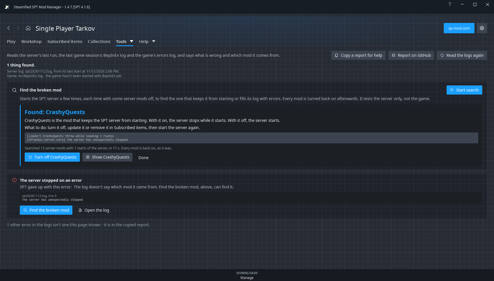

# Diagnose logs

**Tools > Diagnose logs** reads SPT's logs, explains in plain words what went wrong, and names the
mod it came from when the log names it in a way that can be traced. Nothing on the page changes any
file.

## After a crash

You don't have to remember this page is here. While SSPTMM is open, it notices when:

- the **SPT server** stops unexpectedly or fails to start - also a server you started outside SSPTMM;
- the **game** crashes.

A red bar then appears at the top of the window, with a **Diagnose logs** button that opens this
page. If SSPTMM isn't the window in front, a Windows notification says the same. Quitting the game
normally, closing it from SSPTMM, or stopping the server yourself doesn't show the bar.

## What it reads

| Log | Where | What is read |
|---|---|---|
| Server | `<server>\user\logs\spt\spt<date>.log` | Only the server's **last run** in its newest log - what a run before a fix said is no longer true. |
| BepInEx | `BepInEx\LogOutput.log` | The last game session (BepInEx rewrites it each start). |
| Game errors | `Logs\log_<date>_<version>\... errors.log` | The newest game session. |

The SPT launcher deletes the game's `Logs` folder each time it starts the game, so only the last
session's game logs exist. The page says so when it sees that.

Logs only describe the last run: after changing something, start the server or the game again, then
press **Read the logs again**.

## What it recognises

| Card | Means |
|---|---|
| A profile won't load | SPT marked a profile invalid. Put back the mod whose items or clothing it holds, or restore a profile backup - or **Turn them on**: SSPTMM sets SPT's own `removeModItemsFromProfile` and `removeInvalidTradersFromProfile` to true in `core.json` (after asking, keeping the file as it was beside it as `core.json.before-ssptmm`), and the server removes what's missing when it next starts. |
| A profile wears clothing from a missing mod | A clothing mod was removed while a character wore its clothes. |
| Raid results weren't saved | The game sent a value the server doesn't know (for example a skill) - usually a mod's game half is loaded but its server half (such as its prepatch in `user\patchers`) is not. |
| The server couldn't start | Its port is in use - most often a server that is still running. |
| The server stopped on an error | SPT gave up ("The server has unexpectedly stopped"). The card shows the error and, when the log shows whose code threw it, the mod. When it doesn't, **Find the broken mod** can find it. |
| A mod didn't load: something it needs is missing | BepInEx skipped a plugin: a mod it needs isn't installed or is too old. |
| A mod didn't load: it doesn't work with another | BepInEx skipped a plugin because another installed one is incompatible with it. |
| A mod didn't load: one it needs didn't | A knock-on: fix the mod it needs first. |
| A mod is installed twice | BepInEx skipped a plugin because a newer copy of it is installed. |
| A mod failed to load | BepInEx couldn't load a plugin - often one built for another version. |
| A server mod isn't running | Installed and enabled, but the server's last start didn't list it. |
| SPT's mod loader reported a problem | SPT's own message, shown as it is. |
| A server error while answering the game / A server task keeps failing | Traced to the mod whose code the error came from, when it did. |
| A mod reported an error | A mod's own error line in the server log. |
| Two mods ship the same bundle | SPT could only use one of them. |
| A bundle needs files that aren't there | The game couldn't fully load a mod's bundle. |
| A mod logged errors in the game | A plugin's own error lines in BepInEx's log. |

Each card has the line it was read from (file and line number), and buttons: **Show in Subscribed
items**, **Open its folder**, **Open the log** - plus **Go to Play** or **Profile backups** where they
help. Errors no card knows are counted under the list.

## Find the broken mod

When the server won't start, or its log fills with errors, and the cards above don't name a mod,
**Start search** at the top of the page finds the server mod by trying without some of them.

It starts the SPT server several times with no window. The first start has every server mod on, to
see what is wrong. The second has them all off, to check that it is one of the mods. Each start after
that has half of the remaining suspects on, until one mod is left. Sixty mods take about seven starts.
If that mod is fine by itself, the fault needs a second mod, and the search goes on to find it.

**Recently changed mods first.** While SSPTMM is open it notes when the server was last seen up. If
fewer than half of the server mods were added or changed since then, the third start has every mod
on but those. When the server then starts, the fault is among them and only they are searched,
which takes fewer starts. When it doesn't, the search goes on as usual, one start longer.

| It says | Means |
|---|---|
| Found: a mod | With it on, the server doesn't start (or logs the errors shown). Without it, it does. |
| Found: two mods | Each is fine without the other; the fault shows only with both on. |
| It isn't one of the server mods | The same thing happens with every server mod off. |
| Nothing wrong with the server | The server starts and logs no errors with every mod on. |

The result is a box under the description: the mod's name, a sentence saying what it does to the
server, what to do next, the log lines, and how many mods were searched in how many starts and how
long that took. It stays there until you press **Done**, also after SSPTMM is restarted. If SSPTMM
isn't the window in front when the search ends, a Windows notification says the result.

While it runs, the line under the bar says which start it is on, how long the search has taken and,
after the first two starts, about how long is left.

Under the result:

- **Turn off** turns the found mod off right there, the way Subscribed items does (it asks first
  if other mods need it, or a profile holds its items). **Start server** then opens Play and starts
  the server, to see that it comes up.
- **Show** opens the mod in Subscribed items, where it can also be updated or removed.

The search is also offered where a server is seen to fail: on the **The server stopped on an error**
card when the log doesn't name a mod, and under the server log on Play when the server closed
before it was ready. **Copy a report for help** includes the result while it is on the page.

What it does and doesn't touch:

- Only **server mods** that are on are tried. Game (BepInEx) mods, and mods that are already off, stay
  as they are. It tests the server only: a fault that shows in the game is not found.
- A mod is never tried without the mods it says it needs.
- Mods are turned off the same way Subscribed items does it (moved to `user\mods.disabled`), and
  **every one is turned back on at the end**, also when you press **Stop**. A stopped search says
  which mods it had narrowed the fault down to.
- Your **profiles are copied first** (Options > **SPT profile backups**). If the test starts changed a profile,
  the copy is put back, since nothing was played in between.
- It won't start while the server or game is running, or while downloads are queued, and downloads
  are paused until it is done. Don't start SPT or change mods while it runs.
- If SSPTMM is closed or crashes part way, the next start turns the mods back on, takes the
  search's lines out of the server log and says so. If the server is still running then, the page
  shows **Turn them back on**, which stops it first and leaves the log as it is.
- Errors the server logs even with every mod off (a profile problem, for example) are not looked for.
- What the test starts wrote to the server's log is taken out again when the search ends, so the log
  still ends with your own last run and the cards above read that.

## Copy a report for help

**Copy a report for help** copies what was found, the lines behind it and up to 50 other errors - not
whole logs, and never a profile. Taken out first:

- your user folder (becomes `%USERPROFILE%`) and your Windows user name (`<user>`);
- profile and item ids (each becomes `id-` and six characters, the same each time);
- other players' IP addresses (`<ip>:port`).

The report starts with the versions of SSPTMM, SPT and Windows. **Report on GitHub** opens a new
issue on SSPTMM's GitHub with the report filled in (and copies it, for a long one); nothing is sent
until you submit it there. A failed download's **Copy error** and the crash message's buttons do the
same for one error.

Paste it into a [GitHub issue](https://github.com/trappuss/SSPTMM/issues) or wherever you ask for
help.
