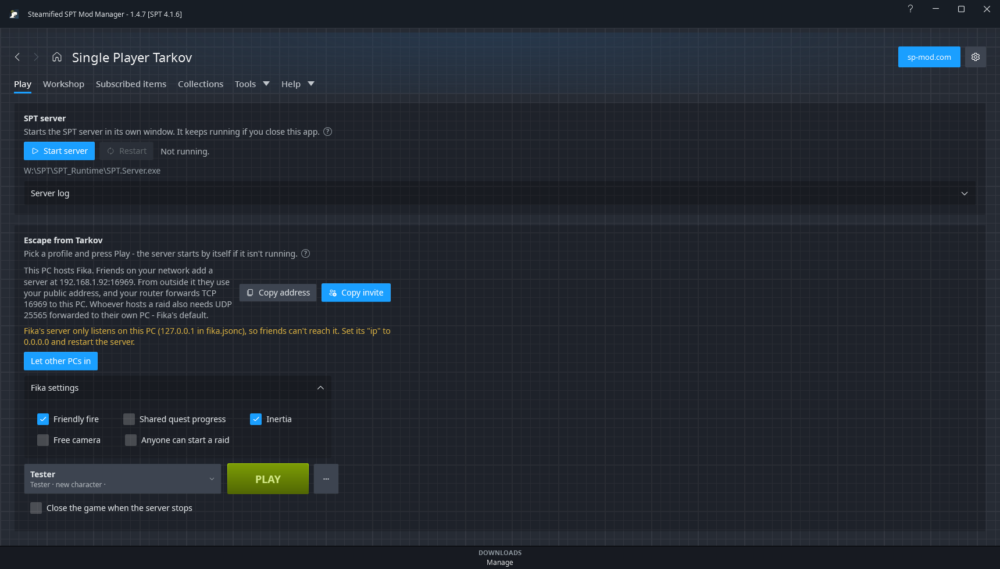
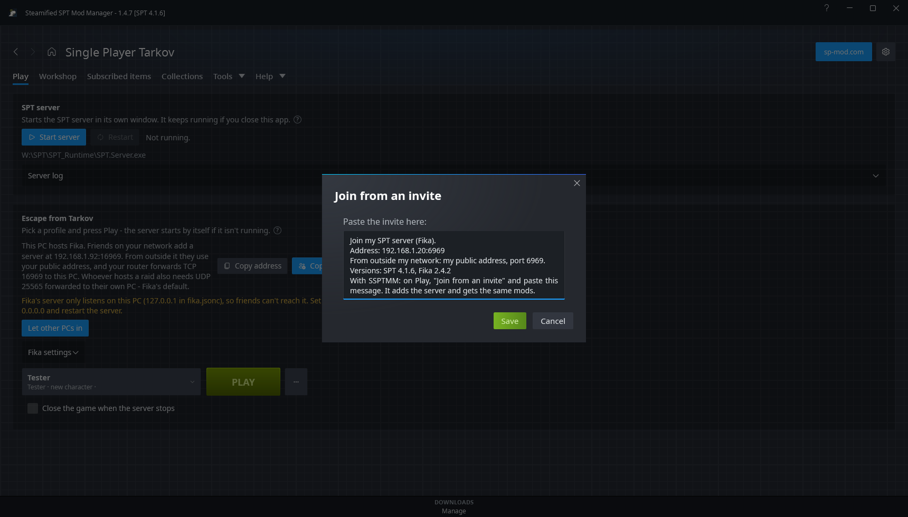
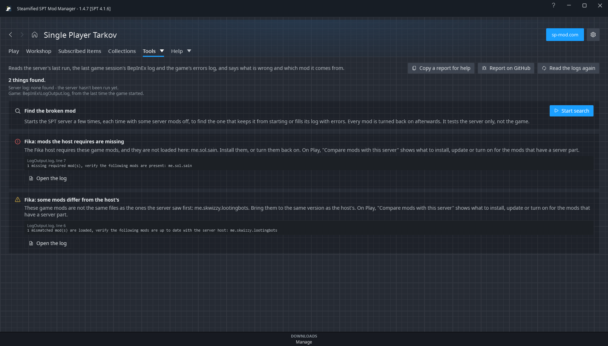

# Playing with friends (Fika)

[Fika](https://sp-mod.com/mod/2326/project-fika) is the mod that lets several people play SPT
together. One person, the **host**, runs the SPT server; everyone else, the host included, plays on
it. Everyone needs the same SPT version, the same Fika and the same mods.

SSPTMM doesn't replace Fika. It does the parts around it: getting the server's address to friends,
getting everyone the same mods, and saying what is wrong when something doesn't connect.

These features are marked experimental: they have not been tried against every kind of setup yet.

From 1.4.8, Play's **...** menu has **Fika guide**, which opens this page.

## Before you start

Everyone, host and friends:

1. Have a working SPT install of the **same version**, set up in SSPTMM ([First start](First-Start)).
2. Subscribe to **Project Fika** in the [Workshop](Workshop) and let it install.
3. Leave [Options](Options) > **Start the game from SSPTMM** on (it is by default). The Fika
   features on Play need it.

[Options](Options) > **Fika and servers** > **Play with Fika** is on **Automatic** by default, which
switches the features below on once Fika is installed.

## How to host



1. On [Play](Play), with **This PC** picked, press **Start server**. The first start writes Fika's
   settings file, `fika.jsonc`.
2. If the card says the server only listens on this PC, press **Let other PCs in** and restart the
   server.
3. Press **Copy invite** and paste the message to your friends (Discord, for example).
4. Press **PLAY** yourself and pick your profile.

Who can reach you depends on where your friends are:

| Friends are | They use | You need |
|---|---|---|
| On your home network | The address marked **same network** | Nothing more |
| On your Tailscale network | The address marked **Tailscale** | Tailscale running on both PCs |
| Anywhere else | Your public address (the invite can carry it, see below) | Your router forwarding **TCP** on the server's port (6969 unless changed) to this PC |

Whoever hosts a **raid** also needs **UDP 25565** (Fika's default) to reach their own PC: the raid
runs in that player's game, not in the server. Fika's own guides cover routers, VPNs and the rest:
[wiki.project-fika.com](https://wiki.project-fika.com/).

### What the hosting card has

- **Your addresses**, with the port from `fika.jsonc`. **Copy address** copies the first one.
- **Copy invite**: a message with the addresses, the port to use from outside your network, your
  SPT and Fika versions, and what a friend does with it. When your mod list fits in a message, the
  invite ends with a share code for it, so friends get your game-only mods too. It looks like this:

  ```
  Join my SPT server (Fika).
  Address: 192.168.1.5:6969 (same network) and 100.72.1.9:6969 (Tailscale)
  From outside my network: my public address, port 6969.
  Versions: SPT 4.1.6, Fika 2.4.6
  With SSPTMM: on Play, "Join from an invite" and paste this message. It adds the server and gets the same mods.
  ```

- **Your public address in the invite** (from 1.4.8, off by default): with
  [Options](Options#fika-and-servers) > **Public address in the invite** on, the third line gives
  the address itself, such as `203.0.113.7:6969`, and a friend's SSPTMM tries it with the others.
  Copy invite asks `api.ipify.org` for it, and everyone who gets the invite sees it. It only works
  when your router forwards the port; an internet provider that shares one address between several
  customers can't be reached from outside at all, and SSPTMM leaves such an address out.
- **Fika settings**: friendly fire, shared quest progress, inertia, free camera and whether anyone
  can start a raid, as tick boxes. A change applies the next time the server starts. The first time
  SSPTMM changes `fika.jsonc`, it keeps the file as it was beside it, as
  `fika.jsonc.before-ssptmm`.
- **A firewall notice** when Windows Firewall has no rule that lets the server's port in, or UDP
  25565 in for hosting a raid. SSPTMM only reads the rules and changes none. It can't see another
  firewall, or your router.
- **Headless client**: if this install has Fika's headless launcher, **Start with the server**
  starts it once the server is up.

Closing SSPTMM while the server runs asks first, since the server keeps running for your friends.

## How to join



1. On [Play](Play), press **...** > **Join from an invite...**, paste the host's message and press
   **Join**. Any message with the server's address in it works.
2. SSPTMM tries the addresses in it, adds the server that answers and picks it. It says so if the
   invite is for another SPT version than yours.
3. Look at the mods line on the card. If it says mods differ, press **Review and install**, check
   the preview and press **Apply**. Nothing is installed before that.
4. Pick a profile, or make one with **...** > **New profile...**, and press **PLAY**.

No invite? **...** > **Add a server...** takes a name of your own and the address the host gave you
(`203.0.113.7`, `fika.example.org:6969`; without a port, 6969).

Pick **This PC** in the server list to go back to your own server.

### Getting the host's mods

- SSPTMM asks the host's server which **server mods** it has loaded and compares them with yours.
  The host needs nothing for this: any SPT 4.1 server answers.
- **Review and install** makes a collection named **Mods on** and the server's name and opens its
  preview in [Collections](Collections): what would be installed, updated or turned on. Applying it
  never turns a mod off.
- A server can't see its game's own plugins, so **game-only mods** come along only when the invite
  carries the host's mod list.
- A mod that isn't on sp-mod.com is named as one to get by hand.
- A server-only mod you need no part of can be removed from the collection before applying. It
  then stays out.
- Fika has its own line: the host's Fika version beside yours, or that Fika isn't installed here.

### Your character

Profiles are on the host's PC: the list on Play shows the ones on that server, and **New profile**,
**Delete** and **Wipe** act on them.

SSPTMM keeps **copies of your profile** on your own PC: one when Play is opened and one a few
seconds after the game closes, when it changed, the newest ten. **...** > **Open this server's
profile copies** shows them. A copy is an ordinary SPT profile file. Nothing is sent back to the
server from here.

## When it doesn't work

| What you see | What to do |
|---|---|
| The server doesn't answer | Check the address, that the host's server is running, and that its port is open to you (the host's firewall notice and router). |
| The invite is for another SPT version | Everyone needs the same SPT version as the host. |
| Mods differ | **Review and install**, then **Apply**. |
| The server showed a different certificate | Normal right after the host set SPT up again: **Trust the new certificate**. Otherwise it may not be the same server. |
| This PC's own server is running too | Stop it. With Fika only the host runs a server, and a stray one can keep friends from seeing each other. |
| The game closes or Fika refuses you | Open [Diagnose logs](Diagnose-Logs). It explains what Fika logged: mods the host doesn't allow, mods it requires, mods that differ from the host's, or a server without Fika or with an older one. |



When the server stops unexpectedly or the game crashes, a red bar at the top of SSPTMM says so, with
a **Diagnose logs** button.

## More detail

- [Play](Play#another-pcs-server-fika): every option for another PC's server and for hosting.
- [Options](Options#fika-and-servers): Play with Fika, what this machine is, the headless launcher.
- [Collections](Collections): sharing a mod list by code, file or shared folder.
- [Tools](Tools): Server Map, for a server that hands out its own mod list.
