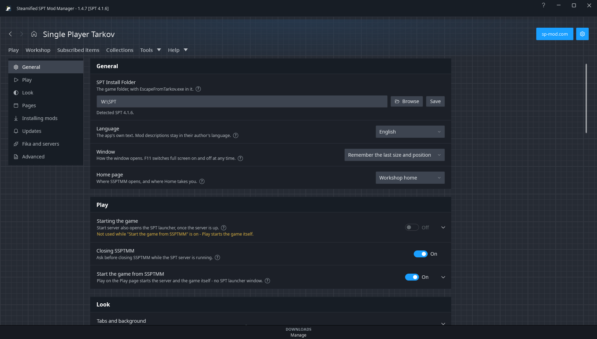

# Options

The gear at the top right. Each setting has a one-line explanation and a **?** with the rest.

## General

| Setting | What it does |
|---|---|
| SPT Install Folder | Your SPT **game** folder, with `EscapeFromTarkov.exe` in it. Its SPT version sets Browse's version filter and flags mods that don't run on it. |
| Language | The app's own text: English, Deutsch, Français, Italiano, Русский or 简体中文, or Windows' own language when it is one of them. Mod descriptions stay in their author's language. The translations are machine-made and not yet read by native speakers. |
| Window | How the window opens: remember the last size and position (default), or other choices. F11 switches full screen at any time. |
| Home page | Where SSPTMM opens and where the Home button goes: Workshop home (default), Browse, Subscribed items, Collections, Play, or Where I left off (the page on screen when SSPTMM was last left). Opening it from an update notification still goes to Subscribed items. |

## Play

| Setting | What it does |
|---|---|
| Starting the game | Start server also opens the SPT launcher once the server is up; run the server without its window. |
| Closing SSPTMM | On by default. Closing SSPTMM doesn't stop the SPT server, so while it runs, closing the window or Quit in the tray asks first. The question's **Don't ask again** turns this off. Closing to the tray doesn't ask: SSPTMM keeps running there. |
| Start the game from SSPTMM | On by default. Play on the Play page starts the server and the game itself, with no SPT launcher window. See [Play](Play#play-from-ssptmm). Also: leave SSPTMM open when the game starts. While it is on, Start server no longer opens the SPT launcher. |

## Look

| Setting | What it does |
|---|---|
| Tabs and background | Hide the Subscribed items or Collections tab (both stay under Workshop > Your Items), or put a picture of your own behind the window, darkened and blurred as far as you like. |
| Accent colour | Steam blue, one of five others, or any colour as six hex digits (#5BA32B). Every one of Steam's blues in the window follows it at once, lighter and darker shades too. |
| OLED black | The pages black instead of Steam's navy; cards, bars and dialogs keep a little light so they stand off the page. Pictures and the accent are left as they are. |
| Card size | Compact, Normal or Roomy cards and rows on Subscribed items: smaller pictures and more to a row, or larger and fewer. Takes hold the next time the page is opened. |
| Picture behind each subscribed mod | On by default. On Subscribed items, each mod's own picture, out of focus, sits behind its card or row, as Steam draws its rows. Off: plain cards - worth trying if the page is slow to scroll. Takes hold the next time the page is opened. |
| Scrolling | Smooth scrolling, as a web browser does, or jump at once. |
| Animations | Workshop cards rising under the pointer and pages sliding in. Pages already open keep the old way until a restart. |
| Interface size | Everything in the window larger or smaller, 80% to 200%; Ctrl+=, Ctrl+- and Ctrl+0 (100%) do the same anywhere. Menus, tooltips and dialogs keep their own size. |
| Look file | **Save look...** writes the accent, OLED black, card size, the background picture (up to 16 MB) with its darkness and blur, and the colours of your groups and mods into one `.ssptmm-look` file. **Load look...** puts all of it in place of what you have; a group takes the colour of the group with the same name in the file. |

## Pages

| Setting | What it does |
|---|---|
| Mod footprint page | Adds the Mod footprint page to Tools. |
| Server map | Adds the Server map page to Tools. |
| Page defaults | What Save as default stored for Browse. (Subscribed items remembers its own filters.) |

## Installing mods

| Setting | What it does |
|---|---|
| Install mode | Install mods for you, or only download them (you install by hand and confirm). |
| Download folder | Where downloaded-only mods are saved. Empty means your Windows Downloads folder. |
| When a downloaded mod shows up installed | Ask you to confirm it, or note it on the mod's card. Confirming keeps update checks right. |
| Open each mod's page first | Show the mod's page (install steps, requirements, warnings) before anything downloads. |
| Keep removed mods | How long unsubscribed mods are kept, so Undo can bring them back. They are kept in `.tcfmm-removed` inside your SPT folder. |
| Downloads | Keep downloaded files for reinstalling (up to 4 GB), or clear them. |
| Unsubscribing | Ask what will be deleted, and what to do with config files, before unsubscribing. |
| Allow changes while SPT is running | Off: installing, removing, switching on or off, Undo and applying a list are refused while the SPT server or the game is open. On: you're asked first and can go ahead (one yes covers a batch). Files in use may fail to move, and SPT only sees a change after a restart. Profiles are never restored while SPT runs. |

## Updates

| Setting | What it does |
|---|---|
| Update notifications | A Windows notification when an installed mod has a new release. Only your installed mods are asked about. |
| Check every | How often. |

## Fika and servers

| Setting | What it does |
|---|---|
| Play with Fika (experimental) | **Automatic** (the default), **On** or **Off**: the Play card's options for another PC's server - the server list and **Add a server...** - and, when this PC hosts Fika, the address to give friends and the ports to forward. Automatic switches them on when Fika is installed; the row says whether its plugin or server mod was found. Needs **Start the game from SSPTMM**. See [Play](Play#another-pcs-server-fika). |
| What this machine is | A player's PC, a Fika headless client, or both - a headless client needs the mods that decide how a raid goes and none of the ones that draw things at a player. |
| Fika headless launcher | Only needed if `FikaHeadlessManager.exe` isn't at the top of the install folder. |
| Server map connection | The address and port from your SPT launcher, and the key if the server has one; what this machine shares. |

## Advanced

| Setting | What it does |
|---|---|
| Catalogue address | Where mods are listed from: sp-mod.com, or a mirror that answers its API (`/api/v0`) with the same mods and ids, for when sp-mod.com is down. Checked before it is kept; used from the next start. Comments, mod lists and links stay sp-mod.com's. |
| Data files | View or hand-edit the JSON files under `Data\`, including `installed-mods.json`. |
| SPT profile backups | Copies of your profiles, with Put back. See [Safety and backups](Safety-and-Backups). |
