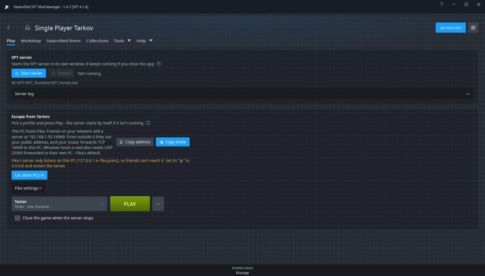
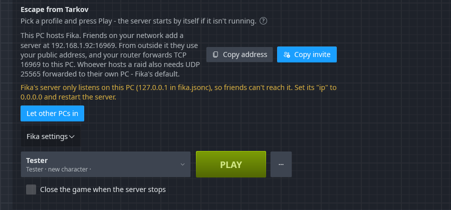
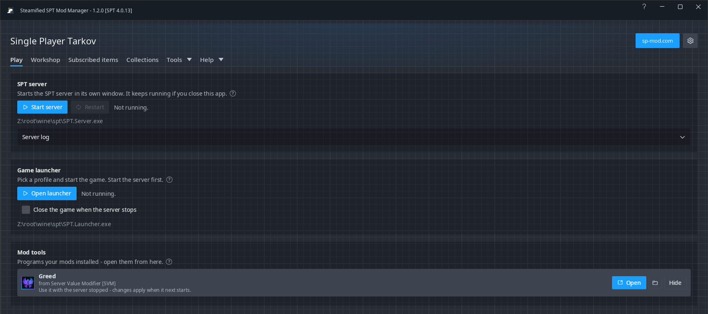

# Play

## Warnings before you launch

Above the buttons, a card appears only when something in your install may not load. It never stops
you from launching.

- **Conflicts** (red): the same mod installed twice, or two copies of a mod that differ. Click it
  for the details.
- **Mods that need something** (from 1.3.0, amber): enabled mods that need a mod that isn't
  installed or is switched off - the same flag Subscribed items shows on their cards. Up to three are
  named; click it to go to Subscribed items.

## SPT server

- **Start server** starts `SPT.Server.exe` in its own window. It keeps running if you close
  SSPTMM.
- While it runs: **Stop server** (red) and **Restart**. Both ask first.
- **Server log** shows the server's log, live, read from its log file - its own window is left
  alone.
- "Running" means running from **this** SPT install. A server from another SPT copy doesn't count.

[Options](Options) > **Starting the game** can open the SPT launcher as soon as the server is up,
and can run the server **without its window** (its log is then only on this page, which also says
if the server closed before it was ready).

## Game launcher

- **Open launcher** opens `SPT.Launcher.exe`, where you pick a profile and start the game. Start the
  server first.
- While the game runs: **Close game**. It asks first - a raid in progress is lost.
- **Close the game when the server stops** (off by default): when the server is seen stopping,
  however it stops, the game is closed too. It watches the SPT install currently set in Options.
  **Stop server** closes the game first, while the server can still answer it, so the game quits
  cleanly in a few seconds. When the server goes some other way (its window closed, a crash), the
  game is closed within about two seconds of the server going, and killed if it hasn't gone two
  seconds after that - with the server gone it can't finish quitting by itself.

## Play from SSPTMM

With [Options](Options) > **Start the game from SSPTMM** on (it is by default; a setup from before 1.4.0 whose settings say off stays off - an install that was
set up before that keeps what it had), the game card has a profile list and a **PLAY** button: pick a
profile and press it. SSPTMM then

1. starts the server if it isn't running, and waits for it (the server log is above if it fails);
2. checks the server and the game files are the same SPT version;
3. does what SPT's launcher does before the game starts: removes the files it removes (BattlEye,
   the old game logs and the rest; anything in its **ExcludeFromCleanup** setting is left), applies
   SPT's game patches, and fetches the mods' bundles;
4. starts the game with that profile, and shows **Playing as** *name*.

No SPT launcher window opens. With **Starting the game** set to run the server without its window,
everything happens in the background. SSPTMM minimises itself when the game starts and comes back
when it closes, unless **Leave SSPTMM open when the game starts** is on.

The **...** button beside Play has the rest:

- **Wipe this profile on the next Play** - the next Play starts the profile over with a new
  character. A copy of your profiles is kept first.
- **New profile...** - a name and an edition, as in SPT's launcher.
- **Delete this profile...** - asks first, and keeps a copy of your profiles first.
- **Clear the game's cache** - what SPT's launcher calls clearing the cache.
- **Open the SPT launcher instead**, and **Settings...**.

Copies kept before a wipe or delete are in Options > **SPT profile backups**.

It works with SPT 4.1.3 to 4.1.6. A newer 4.1 is tried, with a warning on the card. Any other
version, 4.0 included, keeps the **Open launcher** button.

This copies how SPT's 4.1 launcher works, from its source code. The SPT team didn't make it and
doesn't support it. If the game won't start or acts strangely, switch it off and use the SPT
launcher. When you ask for help, say the game was started from SSPTMM. Two differences from SPT's
launcher:

- If the server and the game files are different SPT versions, it stops and says so. SPT's launcher
  only notes it in its log and starts anyway.
- It keeps a copy of the last three game logs before they are cleared, so
  [Diagnose logs](Diagnose-Logs) can still read the last game's errors.

### Another PC's server (Fika)

These options are there with [Options](Options) > **Fika and servers** > **Play with Fika** on - or
on **Automatic**, its default, when Fika is installed. It is marked experimental: it has not been
tried against every kind of setup yet.

The quickest way in is **...** > **Join from an invite...**: paste the message the host copied
with **Copy invite** (or any message with the server's address in it). SSPTMM tries its addresses,
adds the one that answers, picks it, and compares its mods with yours. It also turns **Play with
Fika** on, and says so if the invite names another SPT version than yours.

To play on a Fika host or a friend's SPT server, pick it in the server list above the profiles.
The list shows when there is more than **This PC** on it: the servers added in SPT's launcher are
there, and **...** > **Add a server...** adds one - a name of your own and its address
(`203.0.113.7`, `fika.example.org:6969`, or the `https://` link the host gave you; without a port,
6969). **Remove this server** on the same menu takes back one you added.

With another PC's server picked:

- Play doesn't start a server here. It checks that one answers (a few tries), and if it doesn't,
  says to check the address, that its server is running and that its port is open to you.
- The profiles are the ones on that server. **New profile**, **Delete** and **Wipe** act on
  them, and keep no copy here - the profiles are on the other PC. **Reload profiles from the
  server** on **...** asks again.
- The game files are still this PC's: the clean-up, SPT's game patches and the mods' bundles
  are done here, as SPT's launcher does. Your SPT version and mods have to match the server's -
  for Fika, the host's Fika version too.
- SPT servers make their own certificate, so the first one a server shows is trusted and
  remembered. If it shows another later, Play stops and says so: that is right after the host
  sets SPT up again, and **Trust the new certificate** takes the new one; otherwise it may not be
  the same server.
- **Close the game when the server stops** is hidden: it watches this PC's server only.
- **The server's mods are compared with yours** when its profiles are read, and again each time
  you come back to Play: the card says that they match, or how many are to install, update or
  turn on, with **Review and install** beside it. That makes a collection named **Mods on** and
  the server's name, and opens it in [Collections](Collections) with the preview. Nothing changes
  until you press **Apply**, and applying it never turns a mod off. **Compare mods with this
  server** on **...** asks again and goes straight to the preview. When the server runs Fika, the
  line also gives its Fika version beside yours, or says that Fika isn't installed here. (The two
  halves of Fika carry their own version numbers, so they need not be equal.)
  - The host needs nothing for this: any SPT 4.1 server answers.
  - It knows the host's **server mods** only. An SPT server can't see its own game's BepInEx
    plugins, so game-only mods are not compared.
  - A mod the host runs that you need no part of (a server-only mod) can be removed from the
    collection before applying.
  - A mod that isn't on sp-mod.com is listed as one to install by hand.

Pick **This PC** to go back to your own server.

If this PC's own SPT server is running while another PC's is picked, the card says so: with Fika,
only the host runs a server, and a stray one can keep friends from seeing each other.

### Hosting Fika on this PC

With Fika's server mod installed and **This PC** picked, the card tells you what to give friends:

- this PC's addresses on your network (and on Tailscale, if you use it), with the port from Fika's
  `fika.jsonc` - Fika ignores `http.json`'s address and port. **Copy address** copies the first.
- **Copy invite** copies a message to paste to friends: the addresses, each marked as on the same
  network or on Tailscale, the port to use from outside your network, your SPT and Fika versions,
  and what a friend does with it in SSPTMM (**Join from an invite...**).
- From outside your network, friends use your public address instead, and your router forwards
  **TCP** on that port to this PC. Whoever hosts a raid also needs **UDP 25565** (Fika's default)
  forwarded to their own PC - the raid runs in the host's game, not in the server.
- If `fika.jsonc` only listens on `127.0.0.1`, nobody else can reach the server: the card says to
  set its `"ip"` to `0.0.0.0` and restart the server.
- If there is no `fika.jsonc` yet, start the server once: Fika writes it then.
- If **Windows Firewall** has no rule that lets the server's port in to `SPT.Server.exe` - or, for
  hosting a raid, UDP 25565 in to the game - the card says so and where to allow it. SSPTMM only
  reads the rules; it changes none. It can't see another firewall, or your router.

Fika's own guides cover VPNs, headless clients and the rest: [wiki.project-fika.com](https://wiki.project-fika.com/).

## Mod tools

Some mods ship a program of their own - SVM's **Greed** configurator, give-ui's app. The
**Mod tools** card lists every `.exe` an installed mod put in your SPT folder, by itself, each with:

- **Open** - starts it from its own folder;
- a folder button - the mod's folder (for SVM, where its presets are);
- **Hide** - takes it off the card. "Show N hidden tools" brings it back.

For tools it knows, the card says what they need: give-ui needs the server **running** (with Start
server beside it), Greed is used with the server **stopped**. A tool whose mod is disabled is greyed
out. The card only appears when at least one tool is found.
