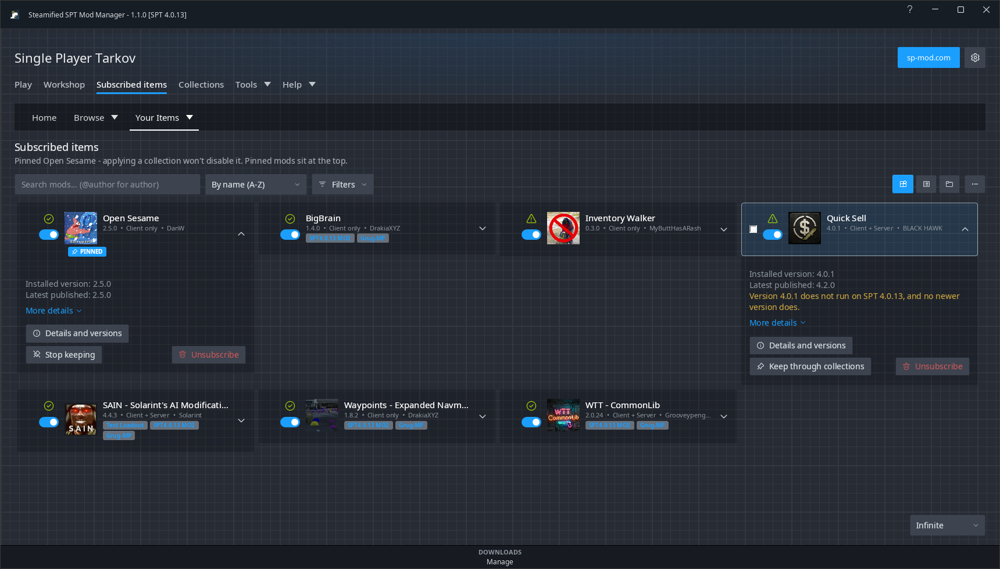
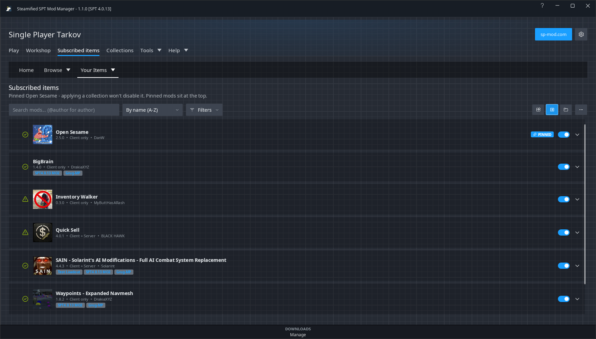
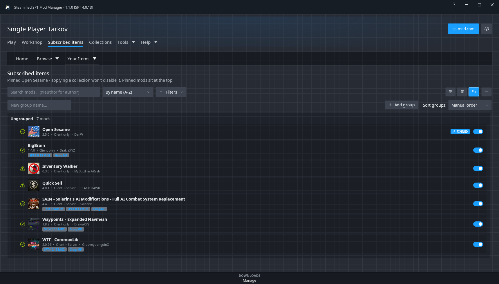
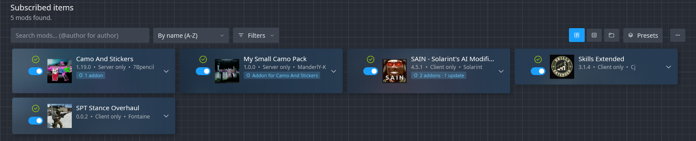
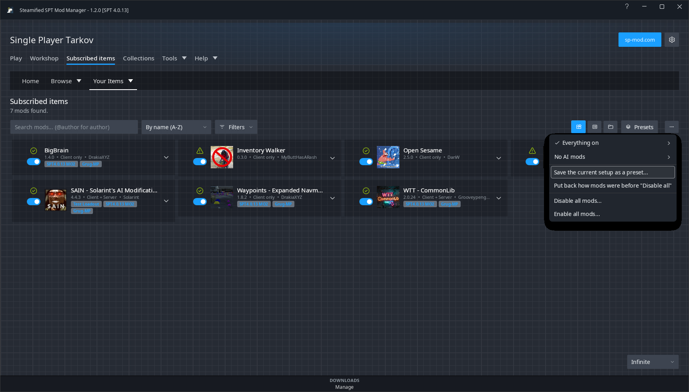

# Subscribed items

Every mod in your SPT folder - ones SSPTMM installed and ones you installed by hand - matched to
sp-mod.com so updates work.

## Views

The three buttons at the top right switch between **Cards**, **List** and **Groups**. All three show
the same details; click a card or row to open it.

| List | Groups |
|---|---|
|  |  |

- **Groups** are your own: type a name and **Add group**, then drag mods into them - in every view.
  Drag one of several picked mods (Ctrl+click, Shift+click) and they all go. Or right-click a mod:
  **Add to group** lists your groups, **New group...** asks for a name, and **Remove from group** puts
  it back - on every picked mod when it is one of them. A group's header can enable, disable or
  invert all its mods at once. Renaming a group to the name of another offers to put its mods in
  that one instead.
- **Filters** also has **grouping** for Cards and List: by your groups, by sp-mod.com category, or
  **by enabled / disabled**.

## Sort, search and filter

- **Sort**: by name, author or group (A-Z / Z-A), **Recently installed** (newest install or
  update first), or **Enabled first** / **Disabled first** (each half by name).
- **Search** by name, or **@name** for the author, or **color:red** for the mods drawn in a
  colour (a colour's name, a hex like `color:#5BA32B`, or `color:none`).
- **Filters**: update status (updates available, up to date, not on sp-mod.com, recently
  installed), enabled/disabled, category, group, colour, and Fika compatible, Fika incompatible,
  Fika compatibility unknown, hide ads, has dependencies, has addons, **addons only** (your addons,
  and the mods you have addons installed for), **hide addons**, downloaded but not confirmed,
  has conflicts. The three Fika ticks add up: Compatible and Unknown shows both.
- The page **remembers** its filters, sort, grouping and view: it opens the way you left it. The
  search box is not kept. **Clear filters** puts the filters, sort and grouping back to the app's own.

## On each mod

- **Addons**: a mod you've installed addons for has a puzzle chip under its name with how many, and
  how many have an update. Hover it for the list; click it for the mod's dialog, where they update
  and come off. An addon with a folder of its own has a card of its own, straight under its mod's.

  

- The **switch** enables or disables it. Disabling moves its files aside (nothing is deleted) and
  first checks what else needs it.
- A blue **Update** when an update for your SPT is out, and **Update all** at the top. An update
  that would break another installed mod is held back and says so: Update all leaves it out, and
  update notifications don't announce it. Update all goes in dependency order - a library before
  the mods that use it. A disabled mod is updated too and stays disabled.
- **To update some mods and not others**, click the arrow beside Update all, or right-click Update
  all. Each waiting update is listed with its versions, and **hand-installed** or **switched off**
  where that applies. A row's button updates just that mod and then shows how it is going -
  waiting, the download's percentage, installing, then a tick. A failed one gets a retry button,
  and **Open Downloads** shows why. **Skip** skips that update until a newer one comes out.
- When Update all includes mods you installed yourself, SSPTMM warns that their new files go on
  top of the old ones, and offers **Update all**, **Only the others** (the rest are updated,
  yours are left as they are) or Cancel.
- Right-click a mod for **Rename...** (a name of your own; empty gives it back its own), **Open
  client folder** and **Open server folder**, beside the group items. Also:
  - **Note...** - a line of your own, shown under the mod's name and found by the search.
  - **Skip this update (version)** - the mod stops showing as out of date, and Update all and
    notifications leave it out, until a newer version comes out. **Stop skipping** undoes it.
  - **Go back to (version)** after an update - the copy kept when it was updated goes back, with
    its configs as they were, offline. The version you leave is kept, so you can go forward
    again. Only while [Options](Options) > Keep removed mods still holds the old copy.
  - **Colour** - a strip down the mod's left edge, in one of ten colours or one of your own
    (six hex digits). It wins over its group's colour; **No colour** takes it away.
  - With several mods picked (Ctrl+click, Shift+click, Ctrl+A): Enable, Disable, Update and
    Unsubscribe for all of them, Add to group and Colour.
- Flags when the installed version doesn't run on your SPT, or when it needs a mod that is missing
  or disabled - read from the mod's own files, so it works offline and for hand-installed mods.
- **PINNED** - see below. **RE-UPLOADED** - see below. **DISABLED**.
- Opened: installed and latest version, notes, **More details** (GUID, folders, dates, who
  installed it), **Details and versions**, **Keep through collections**, **Unsubscribe**.

## Presets

A preset is a saved set of which mods are on and which are off, as Mod Organizer 2's profiles keep
them - your Fika setup, everything off for troubleshooting, or anything else. **Presets** in the
toolbar:

- **Save the current setup as a preset...** - saves which mods are on and off right now, under a
  name. A mod with only its client or only its server half on is kept that way.
- Each preset has **Apply**, **Save the current setup over it**, **Rename...** and **Delete...**.
  The one your mods are set to now has a tick.
- **Disable all mods...** and **Enable all mods...** - for troubleshooting.
- **Put back how mods were before "..."** - returns the mods to how they were just before the last
  preset (or Disable all / Enable all) was applied. Kept after a restart, when Undo is gone.

Applying asks first and names every mod it turns off and on. It also says when a mod left on would
be missing something it needs, when it would turn off a mod sp-mod.com marks as changing your
profile, and how many mods it leaves alone: ones in the preset that are no longer installed, and
ones installed after the preset was saved (those stay as they are). Then:

- a copy of your SPT profiles is taken first - if that fails, nothing changes;
- mods are only moved in and out of their `.disabled` folders, as the switch on a mod does - nothing
  is deleted;
- **Undo** puts it back in one step;
- it is refused while SPT is running (unless [Options](Options) allows changes while it runs) or a
  mod is being installed.

Two mods installed into one folder are kept each by itself, and switched by their own files, as
their cards are.

Presets are kept per SPT install, in `Data\mod_presets.json`. To keep a setup at its versions, or
to share it, make a [collection](Collections) of it instead.

## Pinned mods

**Keep through collections** pins a mod: applying one of your [collections](Collections) never
disables it, even when the collection leaves it out - for the HUD and quality-of-life mods you want
whatever collection you switch to. Pinned mods wear a **PINNED** tag and always sit at the top of the
list. **Stop keeping** unpins it.

## Re-uploaded mods

When an author uploads a new file under the **same version number** on sp-mod.com (with a different
size), the mod gets a **RE-UPLOADED** tag and a line saying what changed, and **Get it again**
installs that upload over what you have. A file swapped where it is hosted (for example on GitHub)
while sp-mod.com's listing stays the same can't be seen.

## Picking several

Ctrl+click, Shift+click, Ctrl+A and Esc work as in Steam's library. A bar appears at the bottom with
Select all, Update selected, Enable selected, Disable selected, Unsubscribe selected and Clear.

## The ⋯ menu

Install from file, **Add from GitHub** (see [Subscribing and downloads](Subscribing-and-Downloads)),
**SPT upgrade check** (pick a newer SPT release and see which of your mods are
ready, need an update first, or have nothing yet), Rescan and more.

## Undo

After disabling, enabling or unsubscribing, **Undo ...** appears under the toolbar. Removed mods are
kept for a while (Options > Keep removed mods).
