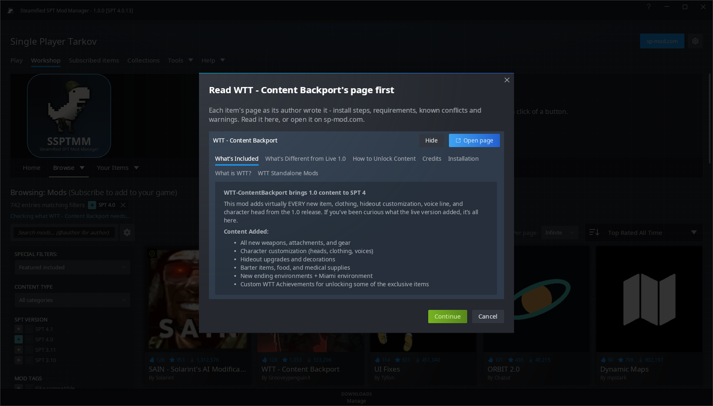
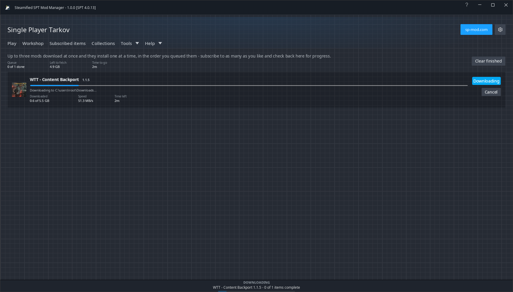
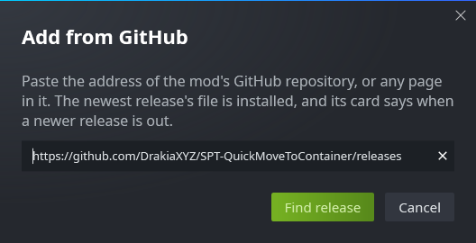
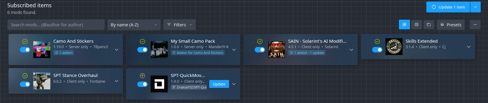

# Subscribing and downloads

## Subscribe

1. **Subscribe** first works out what the mod needs.
2. If it needs other mods you don't have, Steam's **Additional Required Items** dialog asks once:
   **Subscribe to All**, **Subscribe to Just This Item**, or Cancel.
3. Outside the mod's own page, a window shows the mod's page first - its install steps,
   requirements and warnings, and the change notes for an update. **Continue** goes ahead.
   ([Options](Options) can turn this off.)
4. Before anything is placed, you are told about problems: required mods that are disabled, too new
   or the wrong version, conflicts, versions not for your SPT, versions not for Fika on a Fika
   install. You can stop there.
5. **File clashes**: files already on disk that belong to another mod, or to nothing the app
   installed, are listed, and the install waits for **Install Anyway**.

## Downloads

- The **downloads bar** along the bottom always shows what is downloading or installing. Click it
  for the Downloads page.
- **Up to three downloads at once**; installs happen one at a time, in the order you queued them.
  **Pause** on the Downloads page stops new downloads from starting until **Resume**; one under way
  finishes.
- Before a big queue starts, the **free space** on the SPT drive is checked against what the
  downloads take unpacked and installed, with some to spare. When it is short, the queue is
  paused and says how much is needed; **Download anyway** goes on regardless.
- When the queue finishes while SSPTMM is in the tray, a **Windows notification** says how many
  were done and failed; while it is minimised or behind other windows, its taskbar button flashes.
- A mod's sp-mod.com link copied: **Ctrl+V** outside a text box opens its page here, and so does
  dropping the link from a browser on the window.
- A download that fails for a passing reason is retried, and a broken-off one carries on from where
  it stopped when the server allows it. One that fails for good has **Retry** and **Copy error** -
  the reason with the versions of SSPTMM, SPT and Windows, for a bug report.
- Downloads are **kept** (up to 4 GB, oldest-used go first), so installing the same version again
  doesn't download it again. [Options](Options) > Downloads can turn this off or clear them.
- After every install or update, each file on disk is **checked against the archive**. The card
  names any file that is missing or different, and any file the mod tried to put in SPT's own
  folders (which is not placed).

## Download only

**Download only** (beside Subscribe, and on the right-click menu) saves the mod's file to your
download folder without changing anything in SPT. [Options](Options) > **Install mode** can make
that the default for everything (Monitor mode): you install by hand and confirm it on the card, so
update checks stay right.

## Install from file

Subscribed items' **⋯** menu > **Install from file** installs an archive you already have (.zip,
.7z, .rar, .tar, .tar.gz). You can also drop archives anywhere on the window. Your file is copied,
never moved.

An archive without the usual `BepInEx` or `user` folders - a DLL and a read-me, say - shows what it
holds and asks whether it is a client mod (into `BepInEx\plugins`) or a server mod (into
`user\mods`). A single folder is kept as the mod's folder; loose files go into a folder named for
the mod. Check the mod's page if you're not sure; Cancel installs nothing.

## Add from GitHub

Subscribed items' **⋯** menu > **Add from GitHub** installs a mod from the newest release of its
GitHub repository. Paste the repository's address, or any page in it (a release, a file). If the
release has more than one archive (a client and a server file, say), you pick one, and updates
take the same kind of file. Files on GitHub aren't checked by sp-mod.com, so install only from
authors you trust.

The mod's card has a chip with the repository's name; click it to open its releases. SSPTMM
reads the repository's releases again after a scan, at most every 30 minutes. When a newer release
is out, the card offers **Update** and **Update all** includes it. A release that is only source
code, with no .zip, .7z or .rar, can't be installed. GitHub doesn't say which SPT a release is
for, or what else it needs, so check its page.

## Unsubscribe

- **Unsubscribe** asks first: what will be deleted, and whether to keep or delete the mod's config
  files. **Don't ask again** turns the question off (Options > Unsubscribing turns it back on);
  while it is off, config files are always kept.
- It warns when other installed mods still use this one, and - for mods sp-mod.com marks as making
  permanent profile changes - that removing (or turning off) the mod can leave a profile SPT won't
  load. See [Safety and backups](Safety-and-Backups).
- Removed files are kept for a while (Options > Keep removed mods), and **Undo removing** at the top
  of Subscribed items puts them back.
